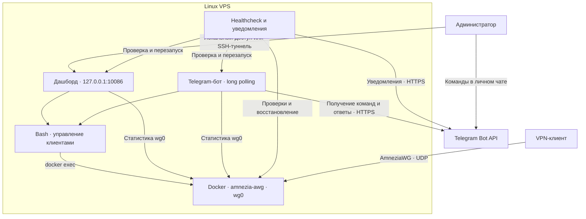

# AmneziaWG Operations Toolkit

**Развёртывание и эксплуатация VPN на VPS: управление клиентами, веб-дашборд, Telegram-бот и автоматические проверки состояния.**

`Linux` · `Docker` · `Python` · `Bash` · `AmneziaWG` · `systemd` · `Telegram Bot API`

## О проекте

Личный инфраструктурный проект для повседневного управления AmneziaWG-сервером. На арендованном VPS развёрнут контейнер с VPN, а операции создания клиентов, выдачи конфигураций и проверки состояния вынесены в собственные инструменты на Python и Bash.

Задача проекта — сократить ручные операции на сервере и быстрее обнаруживать проблемы: добавлять устройства через интерфейс, видеть активность пиров, получать уведомления и выполнять базовые действия по восстановлению сервисов.

Проект использует готовую реализацию [AmneziaWG](https://docs.amnezia.org/ru/documentation/amnezia-wg/) — протокола на основе WireGuard с обфускацией трафика. Предмет этого репозитория — инструменты управления и эксплуатации сервера; разработка самого VPN-протокола в него не входит.

> **Статус:** используется на личном VPS. Опубликованные скрипты привязаны к конфигурации этого стенда; для переноса на другой сервер требуется адаптация. Полностью автоматическое развёртывание с нуля пока не реализовано.

## Возможности

| Возможность | Веб-дашборд | Telegram-бот |
| --- | --- | --- |
| Список клиентов и время последнего handshake | Да | `/clients` |
| Число активных и зарегистрированных пиров | Да | `/clients` |
| Накопленный входящий и исходящий трафик | Да | `/clients` |
| Текущая скорость по изменению счётчиков | Да | Нет |
| Создание клиента | Да | `/addclient` |
| Выдача конфигурации и QR-кода | Просмотр и скачивание | Текст конфигурации и QR-код |
| Переименование клиента | Да | Нет |
| Удаление клиента | Да | Нет |
| Состояние сервера и сервисов | Нет | `/status` |
| Последние записи health-лога | Нет | `/health` |

Дополнительно реализованы резервная копия серверного конфига перед изменениями и скрипт проверок с уведомлениями и попытками восстановления.

## Архитектура



VPN работает в контейнере. Дашборд, бот и служебные скрипты выполняются на хосте и обращаются к контейнеру через Docker CLI. Создание клиента использует общий Bash-скрипт для обоих интерфейсов.

SSH-туннель на схеме — способ удалённого доступа к текущей loopback-привязке дашборда. Сам дашборд не создаёт туннель и не настраивает маршрутизацию.

## Реализация

### Управление клиентами

- Создание пары ключей и клиентской конфигурации с параметрами AmneziaWG.
- Назначение следующего адреса в используемой подсети `10.8.1.0/24`.
- Добавление пира в серверный конфиг и применение через `wg syncconf`.
- Формирование QR-кода для импорта на устройство.
- Удаление пира из работающего интерфейса, серверного конфига и локальных файлов клиента.
- Хранение отображаемых имён отдельно от VPN-конфига, в JSON по публичному ключу.

### Дашборд

Веб-интерфейс реализован на стандартной библиотеке Python (`http.server`, `socketserver`). Данные получаются через `wg show wg0 dump`; браузер запрашивает обновления каждые две секунды.

Активность клиента оценивается по последнему handshake: менее 180 секунд назад — «онлайн». Это индикатор недавнего обмена с пиром, а не проверка доступности произвольного приложения на устройстве.

Скорость рассчитывается по разнице счётчиков между запросами. RX/TX берутся с серверного интерфейса; показания не являются результатом speed test. Исторические метрики в отдельной базе не сохраняются.

### Telegram-бот

Бот использует `getUpdates` (long polling): для приёма команд не требуется публичный HTTP-webhook.

| Команда | Назначение |
| --- | --- |
| `/start`, `/help` | Список команд |
| `/status` | Контейнер, число пиров, uptime, load average, диск и состояние сервисов |
| `/clients` | Клиенты, активность, handshake и объём трафика |
| `/addclient` | Создание клиента, отправка конфигурации и QR-кода |
| `/health` | Последние 15 строк health-лога |

### Мониторинг и восстановление

При каждом запуске `awg_healthcheck.sh` последовательно проверяет:

1. Запущен ли контейнер `amnezia-awg`; при остановке пытается запустить его.
2. Отвечает ли интерфейс `wg0`; при ошибке пытается перезапустить контейнер.
3. Есть ли пиры в работающем интерфейсе; при их отсутствии пытается применить сохранённый конфиг.
4. Отвечает ли HTTP-адрес дашборда; при ошибке пытается перезапустить `awg-dashboard`.
5. Активен ли сервис `awg-bot`; при остановке пытается его перезапустить.

События записываются в `/root/awg_health.log`. Уведомления отправляются через `awg_notify.sh`. Для основных сообщений о повторяющейся проблеме предусмотрен интервал не менее часа; отдельные сообщения в ветке восстановления контейнера отправляются напрямую.

Проверки завершаются после первой найденной проблемы. Периодический запуск требует внешнего планировщика.

## Доступ и безопасность

- **Дашборд привязан к `127.0.0.1:10086`.** Процесс не слушает публичный адрес или адрес VPN-интерфейса. При отсутствии внешнего проксирования доступ возможен с самого VPS либо через отдельно настроенный туннель.
- **Команды бота ограничены разрешённым `chat_id`.** Бот сравнивает ID чата с `TG_CHAT` перед выполнением обработчика. Для персонального администрирования используется личный чат владельца.
- **Telegram-токен вынесен в отдельный конфигурационный файл.** В публичной копии используются значения-заглушки.
- **Перед изменением VPN-конфига создаётся локальная резервная копия.** Это помогает вручную восстановить предыдущее состояние.

Граница доступа дашборда сейчас обеспечивается сетевой привязкой и способом подключения к VPS: собственной аутентификации и разграничения ролей в HTTP-приложении нет. 

Клиентские `.conf`, их QR-коды и резервные копии серверного конфига содержат секреты. Они не предназначены для публикации в Git. Отправка клиентской конфигурации через бота означает передачу секрета через Telegram и является ограничением текущей модели выдачи доступа.

## Файлы проекта

| Файл                 | Назначение                                                 |
| -------------------- | ---------------------------------------------------------- |
| `awg_dashboard.py`   | HTTP-дашборд, статистика и управление клиентами            |
| `awg_bot.py`         | Telegram-команды и проверка разрешённого чата              |
| `awg_addclient.sh`   | Добавление пира, конфигурация клиента и QR-код             |
| `awg_delclient.sh`   | Удаление пира и клиентских файлов                          |
| `gen_awg.sh`         | Первичная пакетная генерация клиентов и серверного конфига |
| `awg_healthcheck.sh` | Проверки, журналирование и попытки восстановления          |
| `awg_notify.sh`      | Отправка служебных уведомлений в Telegram                  |
| `awg_telegram.conf`  | Образец параметров Telegram-бота                           |
| `awg_names.json`     | Соответствие публичных ключей отображаемым именам          |

## Окружение и воспроизведение

Текущие скрипты рассчитаны на Linux VPS с Docker, Python 3, библиотекой `requests`, Bash, `curl`, `qrencode` и системными CLI-утилитами. Проверки и перезапуски хостовых сервисов используют `systemd`. Пути `/root/...` и административные операции предполагают привилегированный запуск в текущем варианте стенда.

Перед подключением инструментов необходимы:

1. Настроенный контейнер `amnezia-awg` с интерфейсом `wg0`, командами `wg`/`wg-quick` и конфигом `/opt/amnezia/awg/wg0.conf` внутри контейнера.
2. Настроенные UDP-порт, маршрутизация, IP forwarding и правила firewall/NAT для VPN-сервера.
3. Актуальные серверный публичный ключ, endpoint, подсеть и согласованные параметры обфускации в скриптах.
4. Файлы управления по ожидаемым путям `/root/...`, доступные исполняемые скрипты и каталог `/root/awg_clients`.
5. Заполненный `/root/awg_telegram.conf` с токеном и ID личного чата администратора.
6. Сервисы `awg-dashboard`, `awg-bot` и расписание запуска healthcheck.

Манифест запуска контейнера, unit-файлы, правила сети и расписание проверок в текущий комплект не включены. Поэтому этот раздел описывает зависимости стенда, а не установку одной командой.

Для доступа к дашборду с рабочей машины можно использовать SSH local forwarding, заменив `ADMIN` и `VPS_HOST` своими значениями:

```bash
ssh -N -L 127.0.0.1:10086:127.0.0.1:10086 ADMIN@VPS_HOST
```

После подключения открыть `http://127.0.0.1:10086` в локальном браузере.

## Эксплуатационная диагностика

Примеры команд для уже настроенного VPS:

```bash
# Состояние контейнера и VPN-интерфейса
docker ps --filter name=amnezia-awg
docker exec amnezia-awg wg show wg0

# Проверка привязки дашборда и его ответа
ss -lntp 'sport = :10086'
curl --fail --max-time 5 http://127.0.0.1:10086/data

# Хостовые сервисы и журнал проверок
systemctl status awg-dashboard awg-bot
tail -n 30 /root/awg_health.log
```

Успешный HTTP-ответ сам по себе не подтверждает исправность VPN: нужно проверять поле `error` в JSON и состояние `wg0`. Наличие интерфейса и пиров также не заменяет проверку прохождения трафика с клиентского устройства.

## Ограничения и следующие шаги

- **Воспроизводимость.** Включить описание запуска контейнера, unit-файлы, расписание healthcheck и версии зависимостей; вынести параметры окружения из кода.
- **Надёжность изменений.** Добавить блокировку одновременных операций, проверку диапазона клиентских IP и согласованное восстановление при частичном сбое. Сейчас изменения конфига и файлов не образуют единую транзакцию.
- **Управление секретами и правами.** Явно задавать права файлов, использовать отдельный PSK для каждого клиента, сократить привилегии компонентов и пересмотреть передачу приватных ключей через Telegram.
- **Точность мониторинга.** Проверять HTTP-код и содержимое ответа дашборда, проверять сервис после перезапуска, унифицировать подавление повторных уведомлений и добавить ротацию логов.
- **Проверки изменений.** Добавить ShellCheck, проверку Python и валидацию конфигураций в CI; отдельно проверять создание и удаление клиентов на тестовом стенде.

## Практический фокус

Проект объединяет несколько задач инфраструктурной эксплуатации: обслуживание Linux VPS, работу с Docker и VPN-интерфейсом, автоматизацию на Bash и Python, интеграцию с внешним API, сбор оперативных показателей и реакцию на сбои.

Следующий этап развития — сделать настройку воспроизводимой, изменения конфигурации безопасными при ошибках, а проверку работоспособности автоматической и проверяемой.
